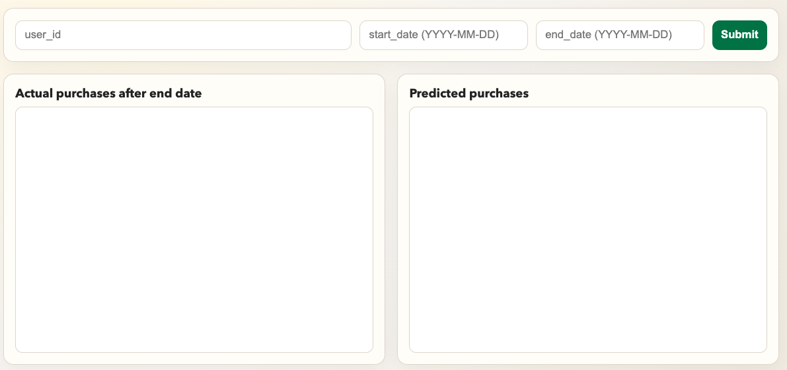
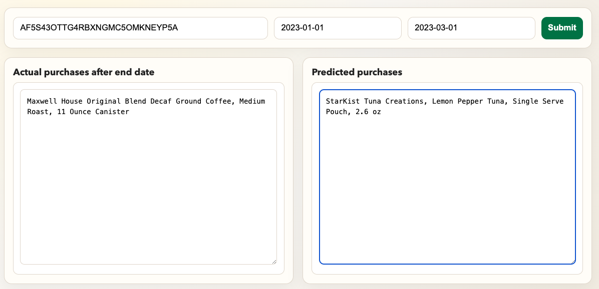

<table>
  <tr>
    <td align="center">
      
       
      <b>Figure 1:</b> Load Page
    </td>
    <td align="center">
      
       
      <b>Figure 2:</b> Load Results
    </td>
  </tr>
</table>

We use Amazon grocery review data to model and predict future shopping behavior. First, a user's purchase history is selected, and a catalog is uploaded to [portal.unboxai.com](https://portal.unboxai.com). 

Given a sequence of purchases within a specific time window, the system predicts what the user will buy next. Finally, we benchmark these predictions against the customer's actual purchases within the time window.

**How to run**

cd examples

python app.py
