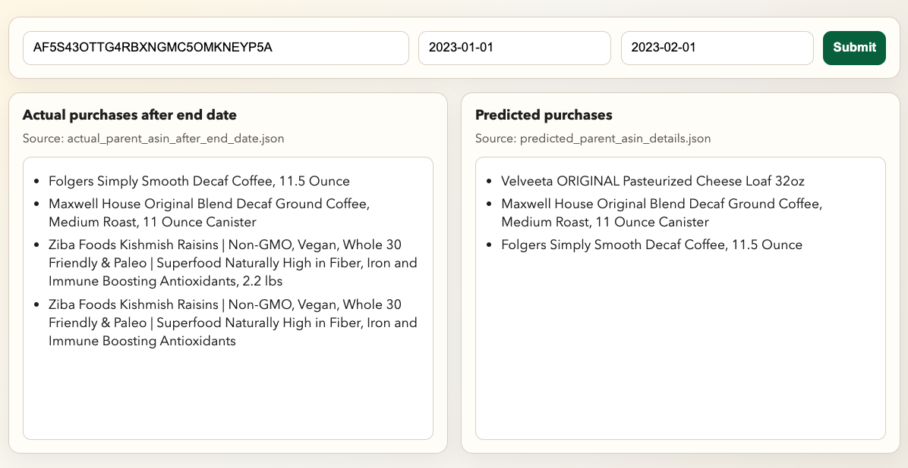

We use Amazon grocery review data to model and predict future shopping behavior. First, a user's purchase history is selected, and a catalog is uploaded to portal.unboxai.com. 

Given a sequence of purchases within a specific time window, the system predicts what the user will buy next. Finally, we benchmark these predictions against the customer's actual purchases after the end date.

How to run

cd examples

python app.py
